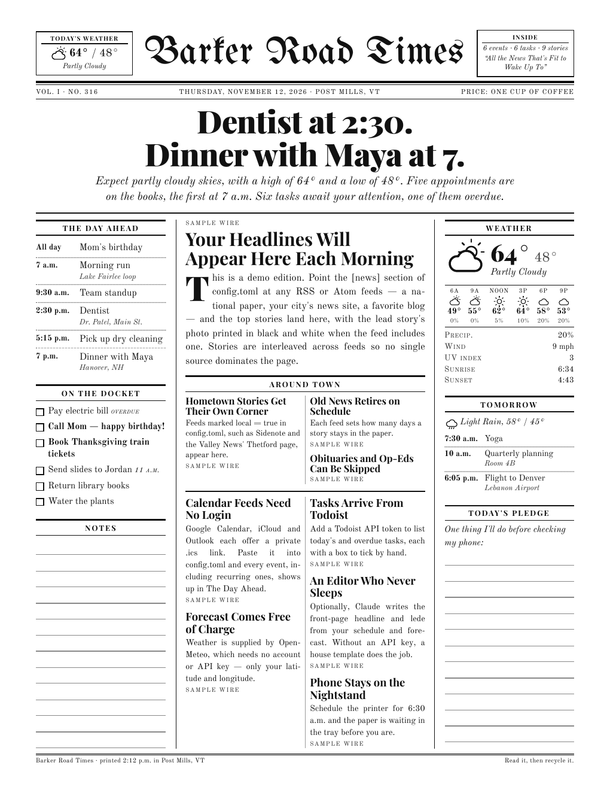

# Barker Road Times

Print a one-page newspaper of **your** day every morning, so the first thing you read
isn't your phone. Your calendar becomes the headline (“Dentist at 2:30. Dinner with Maya at 7.”),
with the weather, today's tasks, tomorrow's plans and a few top stories set as a broadsheet
and sent to your printer before you wake up.



| Section | Source | Account needed? |
|---|---|---|
| The Day Ahead / Tomorrow | Any iCal feed: Google Calendar, iCloud, Outlook | No (uses your private .ics link) |
| On the Docket | Todoist, `today \| overdue` | API token (optional) |
| Weather | [Open-Meteo](https://open-meteo.com) | No |
| Around Thetford | [Sidenote](https://www.sidenote.news) and the Valley News' Thetford page | No |
| News | VTDigger and NPR, or any RSS / Atom feeds | No |
| Headline + lede | A built-in template, or Claude if you add an API key | Optional |

If a source is down, the paper still prints and a small note in the footer says what was missing.

## Quick start

Needs Python 3.10+ on the computer that can reach your printer (a Mac, a Linux box, or a Raspberry Pi).

```bash
git clone https://github.com/iduoj/hello-world.git morning-paper
cd morning-paper
python3 -m venv .venv
.venv/bin/pip install -r requirements.txt
.venv/bin/playwright install chromium   # skip this if Google Chrome is installed

.venv/bin/python -m paper --demo        # sample edition -> out/paper-YYYY-MM-DD.pdf
```

Open the PDF. That's the sample above, built from demo data.

## Make it yours

```bash
cp config.example.toml config.toml
```

Then edit `config.toml` (it's git-ignored, so your private links stay local):

1. **Name your paper.** It's `name = "Barker Road Times"`; change it any time. Add your city and time zone.
2. **Weather.** Put in your latitude/longitude (right-click any spot in Google Maps to copy them).
3. **Calendar.** Paste each calendar's private iCal link into `ics_urls`:
   - Google: Calendar settings → your calendar → *Integrate calendar* → **Secret address in iCal format**
   - iCloud: Calendar app → right-click the calendar → *Share Calendar* → *Public Calendar* → copy link
   - Outlook: Settings → Calendar → Shared calendars → *Publish a calendar* → ICS link
4. **Todoist.** Paste your token from Settings → Integrations → Developer (or set `TODOIST_API_TOKEN`).
   Tasks due today and overdue tasks print with a box to tick; change `filter` to any Todoist filter.
5. **News.** Each feed in `[news] feeds` can set:
   - `local = true`, to put its headlines in the "Around Thetford" box instead of the main news column
   - `max_age_days`, how long a story stays in the paper (handy for sites that post weekly)
   - `skip_categories`, to drop tagged stories such as `"Obituaries"` or `"Opinion"`
6. **Claude as editor** (optional). Set `enabled = true` under `[editor]` and add an Anthropic API key.
   Claude then writes the headline and opening paragraph from your schedule and forecast, one small
   request per edition. If the key is missing or the call fails, the template writes them instead.

Preview it with `.venv/bin/python -m paper` (or `--date tomorrow` to see tomorrow's paper tonight).

## Print it

```bash
.venv/bin/python -m paper --list-printers            # names CUPS knows about
.venv/bin/python -m paper --print                    # build today's paper and print it
.venv/bin/python -m paper --print --printer Brother_HL_L2350DW
```

Set `[printer] name` in `config.toml` to skip `--printer`. Printing goes through CUPS (`lp`),
which macOS and Linux already have. On Windows, generate the PDF and print it from there.

## Print it every morning

**macOS:**

```bash
scripts/schedule-macos.sh 06:30          # every day at 6:30 a.m.
scripts/schedule-macos.sh --remove       # stop
```

The Mac has to be on. If it's asleep at 6:30, the paper prints when it wakes. To have it wake on
its own a few minutes early, run `sudo pmset repeat wakeorpoweron MTWRFSU 06:25:00`.
Keep the project somewhere other than Desktop, Documents or Downloads: macOS blocks scheduled
jobs from reading those folders.

**Linux / Raspberry Pi:** `crontab -e`, then add:

```cron
30 6 * * * cd $HOME/morning-paper && .venv/bin/python -m paper --print >> out/schedule.log 2>&1
```

A Raspberry Pi on the same network as the printer works well as an always-on print server.

## How it works

```
paper/
  sources/        calendar_ics.py, weather.py, news.py, todoist.py   (stdlib HTTP, no SDKs)
  editor.py       headline + lede: template, or Claude (structured JSON output)
  templates/      paper.html.j2 + paper.css   (the broadsheet layout)
  render.py       HTML -> PDF with headless Chromium (Playwright, or your installed Chrome)
  printing.py     lp / lpstat
  cli.py          python -m paper
  fonts/          UnifrakturMaguntia, Playfair Display, Old Standard TT (SIL OFL)
```

The page is HTML/CSS, so it's easy to restyle. Open `out/paper-*.html` in a browser while you
edit `paper/templates/`. A small script in the page picks the largest type size at which
everything fits on one sheet, so a busy day shrinks the type rather than spilling onto a
second page.

Your calendar and tasks are fetched straight from your accounts to your computer and don't go
anywhere else, unless you turn on the Claude editor. Then today's events, tasks and forecast
are sent to the Anthropic API to write the headline.

## Troubleshooting

- **"No PDF engine found"**: run `.venv/bin/playwright install chromium`, or install Google Chrome
  (set `CHROME_PATH` if it's in an unusual place).
- **Margins cut off or the page shrinks**: add printer options, e.g.
  `options = ["media=Letter", "fit-to-page"]`, or set `paper_size = "A4"`.
- **Something's missing from the page**: run with `-v` to see which source failed and why.
- **Nothing printed at 6:30 (macOS)**: check `out/schedule.log`, and test the job with
  `launchctl kickstart gui/$(id -u)/com.morningpaper.daily`.

## Development

```bash
.venv/bin/pip install pytest
.venv/bin/python -m pytest                       # fast tests
PAPER_PDF_TESTS=1 .venv/bin/python -m pytest     # also render a real PDF
```

Fonts are licensed under the SIL Open Font License; see `paper/fonts/OFL-*.txt`.
